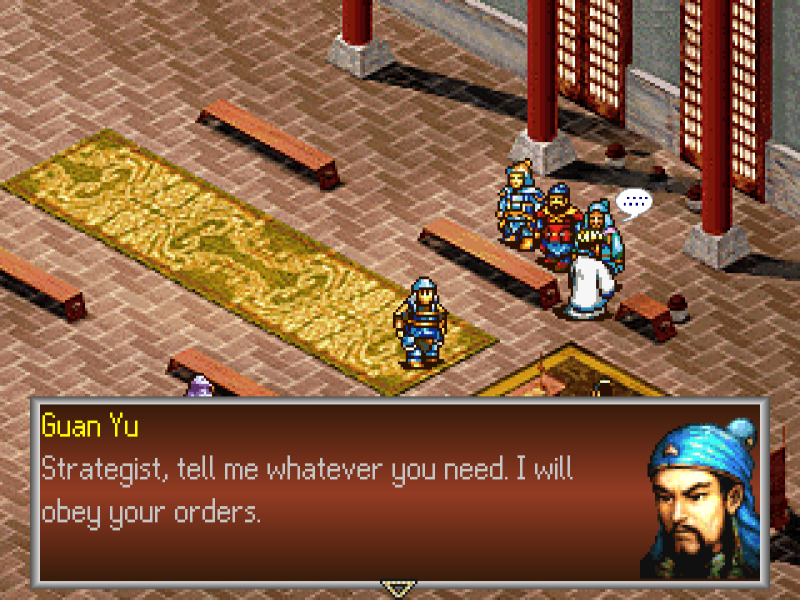
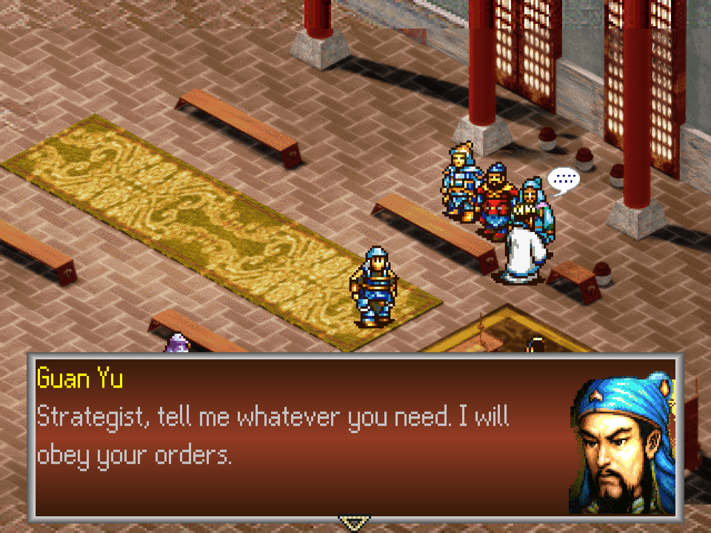
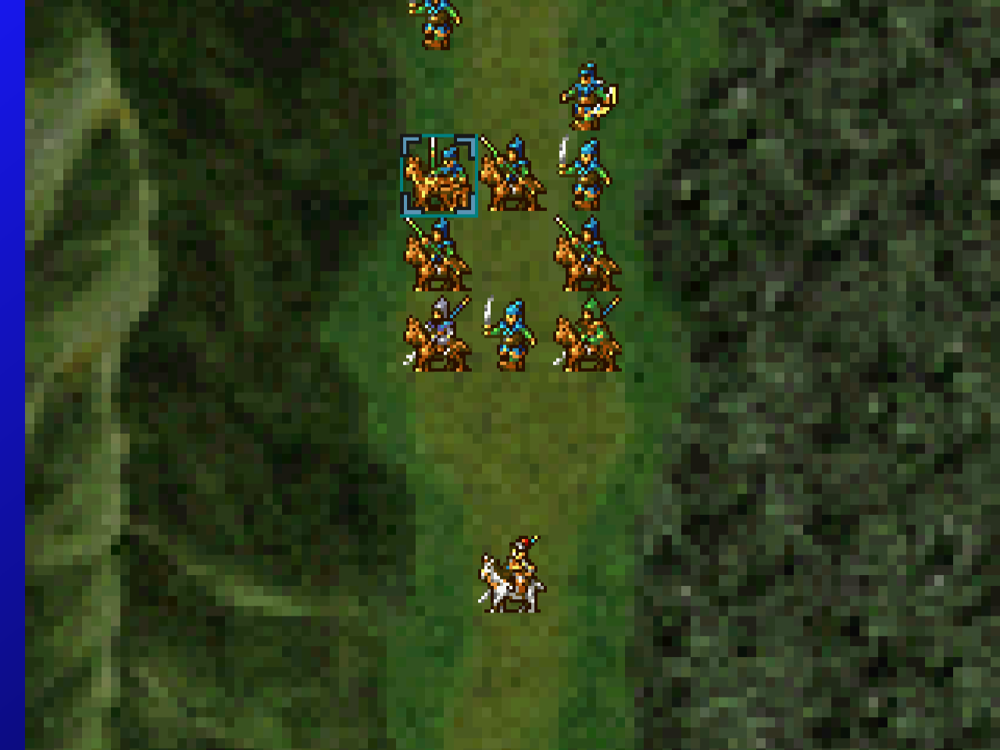
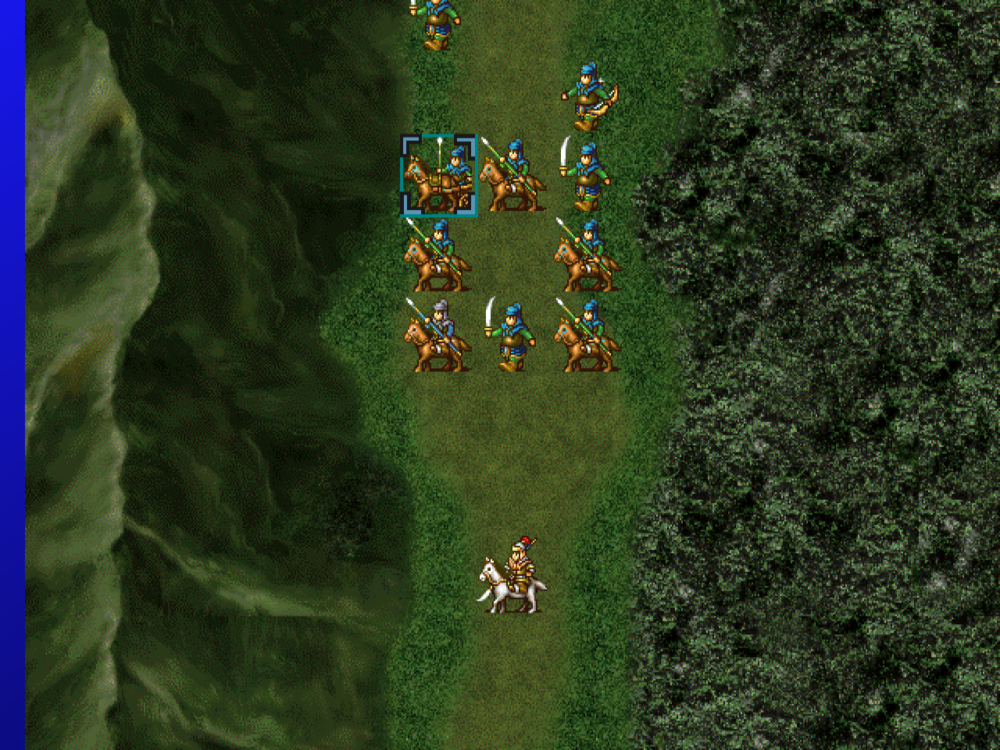
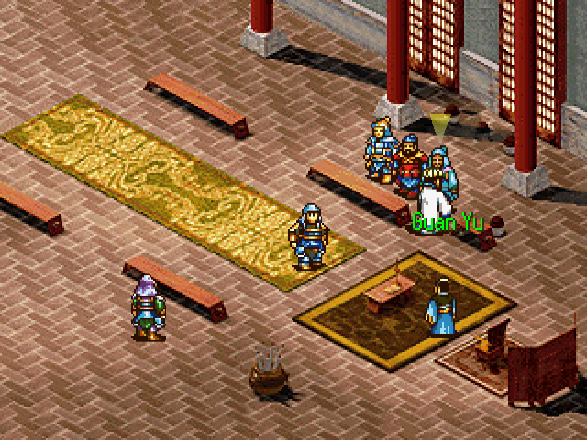
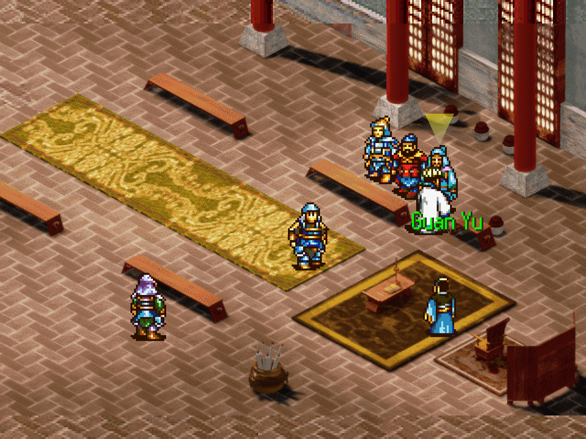

# Sangokushi Koumeiden — HD texture pack builder (DuckStation)

**Sangokushi Koumeiden** (三國志孔明伝, Koei) came out in Japan for the PlayStation and for
Windows 95. The Windows version has the same art drawn at a higher resolution. This repository
holds a script that builds a set of [DuckStation](https://www.duckstation.org/) texture
replacements from that art, so the PlayStation game shows the PC portraits (64x80 instead of
48x64), battle map units (2x), battle maps (6x), and hall and town pictures (2x).

> **This repository contains no game data.** Apart from the screenshots on this page, no
> pictures, palettes or other content from either release are included here or in any download.
> The script reads **your own PC disc and your own PlayStation disc** and writes the PNG files
> on your machine. You need both discs.

It is a companion to the
[English translation patch](https://github.com/damon-daemon/sangokushi-koumeiden-english) but
does not contain it.

## Screenshots

DuckStation at 4x internal resolution, English patch v0.9.4. Left: the PlayStation art. Right:
with the pack.

| Before | After |
|---|---|
|  |  |
|  |  |
|  |  |

## What you need

- **The Windows 95 disc of the game**: the disc itself in your CD/DVD drive, a disc image of it
  (`.iso`, `.img` or `.bin`), or a folder with a copy of its files. Any of the three works.
- **The PlayStation disc as a disc image** (serial `SLPS-00688`): the "Track 1" `.bin` file you
  already use to play. The Japanese original and the English-patched one both work.
- **[DuckStation](https://www.duckstation.org/)**, the PlayStation emulator. The pack does not
  work in other emulators or on a real console.
- **[Python](https://www.python.org/downloads/)** 3.10 or newer, a free program that runs the
  script. You do not need to know Python.

Use the **[English patch](https://github.com/damon-daemon/sangokushi-koumeiden-english) v0.9.4
or later** to see every battle map in full. On the Japanese disc and on older patch versions the
right part of some battle maps stays at the original resolution. Everything else works on any
version.

## Step by step (Windows)

1. **Install Python.** Download it from [python.org](https://www.python.org/downloads/) and run
   the installer. On its first screen tick **"Add python.exe to PATH"**, then click Install.
2. **Download this repository.** On this page click the green **Code** button, then
   **Download ZIP**. Unzip it somewhere easy to find, for example your Desktop.
3. **Open a command window in that folder.** Open the unzipped folder in File Explorer (the one
   that has `hdpack.py` in it), click the address bar at the top, type `cmd` and press Enter.
   A black window opens.
4. **Install what the script needs.** Type this into the black window and press Enter (only
   needed the first time):

   ```
   py -m pip install -r requirements.txt
   ```

5. **Build the textures.** Type `py hdpack.py`, a space, the PC disc, a space, then the
   PlayStation Track 1 file, and press Enter. You do not have to type the file names: drag a
   file from File Explorer onto the black window and its full name is filled in for you.

   With the PC disc in drive `D:`:

   ```
   py hdpack.py D:\ "C:\Games\Sangokushi Koumeiden (Japan) (Track 1).bin"
   ```

   With a disc image of the PC disc:

   ```
   py hdpack.py "C:\Games\koumeiden_pc.iso" "C:\Games\Sangokushi Koumeiden (Japan) (Track 1).bin"
   ```

   Names with spaces need the quotation marks. After about a minute it prints
   `564 replacement textures in ...` and the pictures are in a new folder named `out`.
6. **Copy the textures into DuckStation.** In DuckStation open the menu **Tools > Open Data
   Directory...**. In the folder that opens, go into `textures` (create it if it is not there),
   create a folder named `SLPM-86205`, and inside that a folder named `replacements`. Copy all
   564 files from `out` into `replacements`.

   The folder name must be exactly `SLPM-86205`: that is how DuckStation lists this disc, even
   though the disc's own serial is different.
7. **Turn the textures on in DuckStation.** Open **Settings > Graphics**:
   - On the **Rendering** tab, **Renderer** must be anything except *Software* (*Automatic* is
     fine). Set **Internal Resolution** to 4x or higher, otherwise there is little to see.
   - On the **Texture Replacement** tab, tick **Enable Texture Cache** and
     **Enable Texture Replacements**.
8. **Start the game.**

## Linux and macOS

The same steps in a terminal opened in the repository folder:

```
python3 -m venv .venv
.venv/bin/pip install -r requirements.txt
.venv/bin/python hdpack.py "/path/to/pc_disc.iso" "/path/to/Sangokushi Koumeiden (Japan) (Track 1).bin"
```

Then copy the files from `out/` to `textures/SLPM-86205/replacements/` in DuckStation's data
folder (**Tools > Open Data Directory...**), and change the settings as in step 7 above. With
`-o FOLDER` the script writes straight into a folder of your choice.

## Did it work?

Play until a conversation shows a portrait in the text box: it should look
clearly sharper, as in the screenshots above. In a battle, the map and the units are sharper too.

If nothing looks different:

- The renderer is set to *Software*, or one of the two boxes in step 7 is not ticked.
- The files are not in `textures/SLPM-86205/replacements` (check the spelling, and that the PNG
  files are directly in `replacements`, not in another folder inside it).

If the black window says `'py' is not recognized`, Python is not installed, or the
"Add python.exe to PATH" box was not ticked: run the Python installer again.

If the script stops with a message such as `PC disc: ... files missing`, it names what it could
not find. Check that the first name is the PC disc and the second is the PlayStation Track 1
file.

DuckStation calls its texture cache experimental. If you see wrong pictures, untick the two
boxes again; the pack changes nothing in the game or your saves.

## Options

Add these at the end of the `hdpack.py` line if you want them:

- `-o FOLDER`: write the textures to this folder instead of `out`
- `--pc-colours`: hall pictures keep the PC version's colours instead of the PlayStation
  picture's colours
- `--keep-work`: keep the files read from the two discs in a folder named `work`

## What is replaced and what is not

Only art that exists on the PC disc is used; nothing is upscaled or generated. What stays at
PlayStation resolution:

- **Portraits**: 15 portraits were drawn new for the PlayStation version and have no PC
  counterpart: the Rattan Armor soldiers, Zhuge Xuan, Kongming's mother, Zhuge Ming, Pang Degong,
  Pang Shanmin, Meng Gongwei, the older Sima Yi, Empress Fu, Fu Wan, Empress Zhang, Sun
  Shangxiang, Huang Yueying and two more. Hat tops and plumes that reach above the PC portrait
  frame also stay PlayStation pixels (103 portraits).
- **Battle map units**: the effects (ships, fire ship, fire, confusion cloud, splash, arrows,
  starburst, boulder, slash) were redrawn for the PlayStation and look different on the PC. The
  Chief Strategist unit is a PlayStation-only sprite. Zhang Fei and Zhao Yun have
  their own sprites on the PlayStation only; with the pack they show the PC's Light Cavalry sprite
  (their unit class).
- **Battle maps**: two maps (43 and 44) are not on the PC disc.
- **Halls**: the PC picture covers the middle 200 of the PlayStation's 240 rows; the top and
  bottom 20 rows stay at PlayStation resolution, and the PC part is shown in the PlayStation
  picture's colours so the two join cleanly (`--pc-colours` keeps the PC colours). The PC's red
  exit arrow is painted into its pictures; that spot stays PlayStation pixels. Four halls show a
  person or moved furniture on the PlayStation only; those areas stay as they are. The gate hall
  has no PC picture.
- **Town overviews**: the stone frame above and below the picture is PlayStation-only. One town
  shows another hill on the PlayStation, which is kept, and a few colours (water) are taken from
  the PlayStation picture. Two overviews have no PC picture.
- **No PC picture at all**: the world map (the PC's is another picture), the title, loading and
  settings screens, the terrain strips of the attack close-up, the icons and stat plates, and the
  town and hall character sprites (same size on the PC).

## Repository layout

| Path | Contents |
|---|---|
| `hdpack.py` | The script: reads both discs, runs the generators, writes the PNGs |
| `gen/hdfaces.py`, `hdunits.py`, `hdmaps.py`, `hdbacks.py` | Portraits, battle map units, battle maps, halls and town overviews |
| `gen/ls11.py`, `timdump.py`, `disc.py` | PC archive format, PlayStation TIM pictures, disc image reader |

Tested with DuckStation (OpenGL renderer) on Linux. The Windows steps have not been tried on a
Windows machine yet; please report anything that does not match.

## Credits

- Tools: [damon-daemon](https://github.com/damon-daemon)
- Sangokushi Koumeiden © Koei Tecmo. This is an unofficial fan project, not affiliated with
  or endorsed by Koei Tecmo. Please support the official releases.

## License

The tools and documentation in this repository are released under the [MIT License](LICENSE).
This covers only original work in this repository: the game itself and all of its content
(code, text, graphics, audio) are copyright Koei Tecmo and are not included or licensed here.
